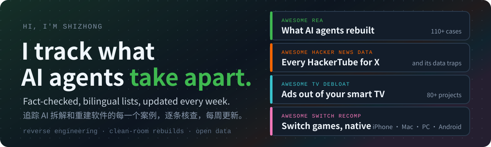
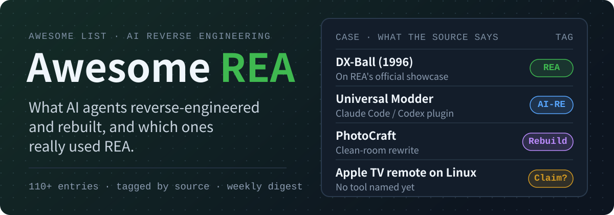

  

  
  
  
  
  

AI coding agents can now take closed software apart and rebuild it. I keep track of what they actually built, which tools they really used, and what you can run today, including the wave of agents cleaning ads off smart TVs and recompiling Switch games to run natively. Every entry links to its own source, and each list is in English and 中文.

## What I maintain

<table>
<tr>
<td width="50%" valign="top">

<b><a href="https://github.com/AIshihzong/awesome-reverse-engineer-anything">Awesome REA</a></b>: what AI agents reverse-engineered and rebuilt, and which ones really used REA.

→ <a href="https://github.com/AIshihzong/awesome-reverse-engineer-anything/blob/main/docs/by-app.md">Find an open-source replacement by app</a> 
→ <a href="https://github.com/AIshihzong/awesome-reverse-engineer-anything/blob/main/docs/is-it-rea.md">Did it really use REA?</a> 
→ <a href="https://github.com/AIshihzong/awesome-reverse-engineer-anything/blob/main/docs/new-this-week.md">New this week</a>

</td>
<td width="50%" valign="top">

<b><a href="https://github.com/AIshihzong/awesome-hacker-news-data">Awesome Hacker News Data</a></b>: every "HackerTube for X", the dataset each one uses, and the traps in that data.

→ <a href="https://github.com/AIshihzong/awesome-hacker-news-data/blob/main/docs/by-source.md">Which data does each site use?</a> 
→ <a href="https://github.com/AIshihzong/awesome-hacker-news-data/blob/main/DATA_QUALITY.md">Data quality traps</a> 
→ <a href="https://github.com/AIshihzong/awesome-hacker-news-data/blob/main/docs/new-this-week.md">New this week</a>

</td>
</tr>
<tr>
<td width="50%" valign="top">

<b><a href="https://github.com/AIshihzong/awesome-tv-debloat">Awesome TV Debloat</a></b>: take the ads, tracking and junk out of the smart TV you already own, with root and undo checked for each project.

→ <a href="https://github.com/AIshihzong/awesome-tv-debloat#find-your-tv">Find your TV</a> 
→ <a href="https://github.com/AIshihzong/awesome-tv-debloat#before-you-start">Before you start</a> 
→ <a href="https://github.com/AIshihzong/awesome-tv-debloat/issues/new?template=project.yml">Submit a project</a>

</td>
<td width="50%" valign="top">

<b><a href="https://github.com/AIshihzong/awesome-switch-recomp">Awesome Switch Recomp</a></b>: play your own Switch and Switch 2 games natively on iPhone, Mac, PC and Android, sorted by device, with the game version each project needs.

→ <a href="https://github.com/AIshihzong/awesome-switch-recomp#find-your-device">Find your device</a> 
→ <a href="https://github.com/AIshihzong/awesome-switch-recomp#find-your-game">Find your game</a> 
→ <a href="https://github.com/AIshihzong/awesome-switch-recomp/issues/new?template=project.yml">Submit a project</a>

</td>
</tr>
</table>

## Most shared AI reverse-engineering cases

| Case | What happened | Tag |
| --- | --- | --- |
| [Universal Modder](https://github.com/rehan-remade/universal-modder) | Minecraft content inside GTA V and other games you own | `AI-RE` |
| [Steam game to Unity in 30 min](https://x.com/AIWarper/status/2109060856466264566) | Decompiled a game the author owns to C# | `REA` (author's post) |
| [Native Plex client for LG TVs](https://github.com/GLinnik21/plx-native) | Faster startup than the stock app | `AI-RE` |
| [DX-Ball](https://github.com/N0zoM1z0/dx-ball) | Byte-exact rebuild checked against 3,205 original cases | `REA` |

[See every case and how it was checked →](https://github.com/AIshihzong/awesome-reverse-engineer-anything#most-shared)

## Stay in the loop

- **Weekly digest:** on any list, click **Watch → Custom → Releases** to get one short digest a week.
- **Know a case that is missing?** [Submit it to Awesome REA](https://github.com/AIshihzong/awesome-reverse-engineer-anything/issues/new?template=case.yml), [to Awesome Hacker News Data](https://github.com/AIshihzong/awesome-hacker-news-data/issues/new?template=project.yml), [to Awesome TV Debloat](https://github.com/AIshihzong/awesome-tv-debloat/issues/new?template=project.yml) or [to Awesome Switch Recomp](https://github.com/AIshihzong/awesome-switch-recomp/issues/new?template=project.yml). Authors of listed projects get a "Featured in" badge if they want one.

<b>中文</b>

我维护四份中英双语、逐条核查的清单，每周更新：

- **[Awesome REA](https://github.com/AIshihzong/awesome-reverse-engineer-anything/blob/main/README.zh-CN.md)**：大家用 AI 逆向、重建了什么，哪些今天就能用，哪些真的用了 REA。可以[按想替代的软件查开源方案](https://github.com/AIshihzong/awesome-reverse-engineer-anything/blob/main/docs/by-app.md)。
- **[Awesome Hacker News Data](https://github.com/AIshihzong/awesome-hacker-news-data/blob/main/README.zh-CN.md)**：基于 Hacker News 数据做的项目、数据集和 DuckDB 查询，以及数据里的坑。
- **[Awesome TV Debloat](https://github.com/AIshihzong/awesome-tv-debloat/blob/main/README.zh-CN.md)**：智能电视去广告、换桌面的开源项目，按电视品牌整理，每条写明要不要 root、能不能还原，国产电视单独一节。
- **[Awesome Switch Recomp](https://github.com/AIshihzong/awesome-switch-recomp/blob/main/README.zh-CN.md)**：Switch 和 Switch 2 游戏的静态重编译和原生移植，用你自己的正版在 iPhone、Mac、PC 和 Android 上原生运行，按设备整理，每条写明需要哪个游戏版本。

想收到每周周报：在仓库页点 **Watch → Custom → Releases**。有漏掉的案例，欢迎[投稿](https://github.com/AIshihzong/awesome-reverse-engineer-anything/issues/new?template=case.yml)。

