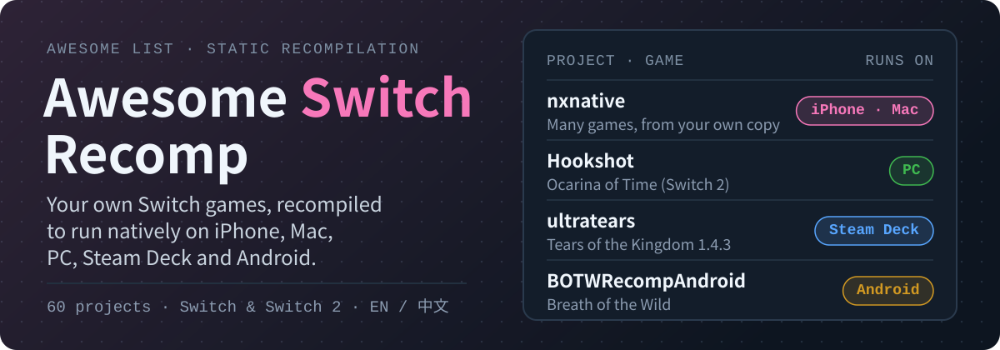

# Awesome Switch Recomp: play your own Switch games natively on iPhone, Mac, PC and Android 

**English** · [简体中文](README.zh-CN.md)

  

  
  
  

**A list of Nintendo Switch and Switch 2 static recompilation (recomp) projects and native ports, sorted by the device you want to play on. Every project here builds the game from a copy you own: no ROMs, no keys, no downloads.**

> Unofficial. Not affiliated with Nintendo or with any project listed. This list links only to source code. It does not host, link to or explain how to get games, keys or firmware.

**[Find your device](#find-your-device)** · **[Find your game](#find-your-game)** · **[What you need](#what-you-need)** · **[Recomp vs emulator](#recomp-vs-emulator)** · **[Submit a project](https://github.com/AIshihzong/awesome-switch-recomp/issues/new?template=project.yml)**

> ⭐ **[Star this repo](https://github.com/AIshihzong/awesome-switch-recomp)** to keep it in your GitHub feed, or **Watch → Custom → Releases** to get one short digest a week of new recomps.

In October 2026 Switch recomps took off: [nxnative](https://github.com/seedds/nxnative) put Switch games on the iPhone and Mac, and Tears of the Kingdom, Ocarina of Time (Switch 2), Breath of the Wild and dozens more followed on PC and Android within weeks. Many were written with AI coding agents. This list sorts <!-- COUNT -->60<!-- /COUNT --> of them by device and says for each one:

- **Game** and **Runs on**: which game, on which devices.
- **Game version**: the update your dump must be on. Most projects support only one.
- **Status**: 🟢 Playable means the README says you can play it; 🟡 Early means it boots or reaches gameplay with big gaps; 🧰 Tool is a builder or app for many games.
- 🤖: the README says it was written mostly with an AI coding agent.

> Star counts and details were checked on <!-- DATE -->2026-11-10<!-- /DATE --> by reading each project's README. These projects change daily, so check the project's own page before you start.

## Contents

- [Find your device](#find-your-device)
- [Find your game](#find-your-game)
- [What you need](#what-you-need)
- [iPhone, iPad and Mac](#iphone-ipad-and-mac)
- [Windows, Linux and Steam Deck](#windows-linux-and-steam-deck)
- [Android](#android)
- [Recompilers: port a game yourself](#recompilers-port-a-game-yourself)
- [The other direction: games recompiled to run on a Switch](#the-other-direction-games-recompiled-to-run-on-a-switch)
- [Recomp vs emulator](#recomp-vs-emulator)
- [Related lists](#related-lists)
- [Contributing](#contributing)

## Find your device

| You want to play on | Start with |
| --- | --- |
| **iPhone or iPad** | [NX2Apple](https://github.com/LNPANDY/NX2Apple) (one-click Mac app, no terminal) or [S2Arm](https://github.com/jhaizhou-ops/S2Arm). You need a Mac to build, or [ns2ios-shell](https://github.com/xinerqu/ns2ios-shell) on Windows. |
| **Mac** (Apple Silicon) | [switch2mac](https://github.com/azmasm/switch2mac), [NX Play](https://github.com/varyform/nx-native-wrapper) or [LumaNX](https://github.com/Xc1Ym/LumaNX), all built on [nxnative](https://github.com/seedds/nxnative) |
| **Windows or Linux PC** | One project per game: see [Find your game](#find-your-game) |
| **Steam Deck** | Projects with a Linux build, such as [ultratears](https://github.com/kuraeow/ultratears), [Recompia](https://github.com/Dittobyte/Recompia) and [xc3-recomp](https://github.com/jmars125/xc3-recomp) |
| **Android phone or handheld** | [DroidPlay Core](https://github.com/enjoyerofslop/droidplay-core) for many games, or [BOTWRecompAndroid](https://github.com/mamcjr/BOTWRecompAndroid) and [TOTKDroid](https://github.com/mamcjr/TOTKDroid) for the two Zeldas |

## Find your game

| Game | PC and Steam Deck | iPhone, iPad, Mac | Android |
| --- | --- | --- | --- |
| **Tears of the Kingdom** | [totk-pc-recomp](https://github.com/valentderah/totk-pc-recomp), [ultratears](https://github.com/kuraeow/ultratears), [Weeping of the Empire](https://github.com/daniel-madrid-07/weeping-of-the-empire) | [totk-mobile](https://github.com/OJZen/totk-mobile), [totk-ios](https://github.com/NicholasDominici/totk-ios) | [TOTKDroid](https://github.com/mamcjr/TOTKDroid), [totk-android](https://github.com/AurelioB/totk-android) |
| **Ocarina of Time (Switch 2)** | [Hookshot](https://github.com/NotRexed/Hookshot), [echora](https://github.com/Mars7x/echora) | [HookLink](https://github.com/dsi-hub/HookLink), [GreenKid-MV](https://github.com/adi0900/GreenKid-MV) | – |
| **Breath of the Wild** | [SavageWindRecomp](https://github.com/Revivedx/SavageWindRecomp) | profile in [NX2Apple](https://github.com/LNPANDY/NX2Apple) | [BOTWRecompAndroid](https://github.com/mamcjr/BOTWRecompAndroid) |
| **Link's Awakening** | [LASRecomp](https://github.com/peiikai/LASRecomp) | [LASRecomp](https://github.com/peiikai/LASRecomp) | – |
| **Mario Kart World (Switch 2)** | [mkw-recomp](https://github.com/adriadam10/mkw-recomp), [MKW-THWOMP](https://github.com/STS78721/MKW-THWOMP) | [kartnative](https://github.com/pahorema/kartnative) | [DroidPlay Core](https://github.com/enjoyerofslop/droidplay-core) (boots) |
| **Super Smash Bros. Ultimate** | [OpenSmash Ultimate](https://github.com/OpenSmash-Ultimate/OpenSmash-Ultimate) | – | – |
| **Pokémon** | [Recompia](https://github.com/Dittobyte/Recompia) (Pokopia), [KarPur](https://github.com/Grunttanamo/KarPur) (Scarlet/Violet), [letsgo-recomp](https://github.com/raulzrrs/letsgo-recomp), [swsh-recomp](https://github.com/raulzrrs/swsh-recomp) | – | [letsgo-recomp-android](https://github.com/CowKillers/letsgo-recomp-android) |
| **Xenoblade Chronicles** | [xc3-recomp](https://github.com/jmars125/xc3-recomp), [xcx-recomp](https://github.com/jmars125/xcx-recomp), [xc2-recomp](https://github.com/AksharDP/xc2-recomp) | – | – |
| **Metroid** | [mp4-recomp](https://github.com/linuxopt/mp4-recomp), [metroid-prime-4-recomp](https://github.com/jaigner-hub/metroid-prime-4-recomp), [Metroid-Dread-Recomp](https://github.com/yozander2009-stack/Metroid-Dread-Recomp) | – | – |
| **Donkey Kong Bananza (Switch 2)** | [dkb-pc-recomp](https://github.com/Lucas-blip-png/dkb-pc-recomp) | – | – |
| **Diablo II: Resurrected** | – | [d2r-mobile](https://github.com/jhaizhou-ops/d2r-mobile) | [d2r-mobile](https://github.com/jhaizhou-ops/d2r-mobile) |

## What you need

1. **Your own console and your own copy of the game**, from a cartridge or an eShop purchase. Every project here builds from files you dump yourself and ships no game data. This list does not explain how to dump games or keys and does not link to anyone who does.
2. **The exact game version** in the project's README. A dump on a different update usually will not build. Check the Game version column first.
3. **A capable device.** Apple projects need Apple Silicon. PC projects usually need a GPU with Vulkan. Android projects usually need a recent Snapdragon chip.
4. **Some patience.** Most of these are weeks old. Expect crashes and graphics bugs, and read each project's known-issues list.
5. **Downloads only from the project's own GitHub releases.** Sites that offer "pre-built" games under these projects' names are not the projects, and a pre-built game contains Nintendo's code.

### Written with AI

Projects marked 🤖 say in their README that most of the code was written with an AI coding agent such as Claude Code or Codex. [ns-game-apple-arm-port](https://github.com/realskyrin/ns-game-apple-arm-port) is itself an agent skill for porting a game to Apple Silicon. For the wider picture of what agents have reverse-engineered, see [Awesome REA](https://github.com/AIshihzong/awesome-reverse-engineer-anything).

## iPhone, iPad and Mac

<!-- BEGIN apple -->
Apple Silicon only (M1 or newer Mac, recent iPhone or iPad). Most of these build on [nxnative](https://github.com/seedds/nxnative): you point a Mac app at your own game files and it builds an app for the Mac, or an IPA you sideload onto an iPhone or iPad. Many also need the `prod.keys` dumped from your own console.

| Project | ★ | Game | Runs on | Game version | Status | What it does |
| --- | ---: | --- | --- | --- | --- | --- |
| [nxnative](https://github.com/seedds/nxnative) | 14.4k | Many games | iPhone/iPad, Mac | – | 🧰 Tool | Turns your own NSP folder into an unsigned iPhone/iPad app or a Mac app: the game code is rewritten for ARM64 and drawn through Metal. Most Apple tools below build on it. |
| [NX2Apple](https://github.com/LNPANDY/NX2Apple) | 5,921 | Many games | iPhone/iPad | – | 🧰 Tool | One-click Mac app that packs your own game into an iPhone or iPad app, no terminal. Has profiles for 147 games. |
| [d2r-mobile](https://github.com/jhaizhou-ops/d2r-mobile) 🤖 | 5,252 | Diablo II: Resurrected | iPhone/iPad, Mac, Android | – | 🟢 Playable | Runs your own Switch copy natively on iPhone, iPad, Mac and Android with full touch controls at a steady 60 fps. |
| [S2Arm](https://github.com/jhaizhou-ops/S2Arm) | 2,342 | Many games | iPhone/iPad, Mac | – | 🧰 Tool | One app for your whole library on iPhone, iPad and Mac, with an in-game gear menu and an editable on-screen gamepad. Bring your own games and keys. |
| [ns-game-apple-arm-port](https://github.com/realskyrin/ns-game-apple-arm-port) 🤖 | 534 | Any game | iPhone/iPad, Mac | – | 🧰 Tool | Agent skill that walks a coding agent through porting a Switch game to Apple Silicon (macOS, iPadOS, iOS) with Rust and Metal. |
| [LumaNX 璃游](https://github.com/Xc1Ym/LumaNX) | 292 | Many games | iPhone/iPad, Mac | – | 🧰 Tool | Chinese and English Mac GUI for nxnative: builds your games to run on the Mac and exports iPhone/iPad IPAs. |
| [totk-mobile](https://github.com/OJZen/totk-mobile) | 209 | Tears of the Kingdom | iPhone/iPad, Mac | 1.4.3 | 🟡 Early | Experimental native port for Apple Silicon Macs and iPads, with an early iPhone build. Checks your files before building. |
| [NX Play](https://github.com/varyform/nx-native-wrapper) 🤖 | 165 | Many games | iPhone/iPad, Mac | – | 🧰 Tool | Mac app to build, play, install and manage your nxnative games, on the Mac and on iPhone or iPad. |
| [switch2mac](https://github.com/azmasm/switch2mac) | 155 | Many games, incl. Switch 2 | Mac | – | 🧰 Tool | Mac app that turns your own Switch and Switch 2 dumps into native Apple Silicon apps, with a game-case library view. Not an emulator. |
| [MetalNX](https://github.com/krushant1122/MetalNX) | 81 | Many games | Mac | – | 🧰 Tool | One-click Switch-to-Mac port studio and graphics tweaker for M1 to M4 Macs, with a compatibility list. |
| [GreenKid-MV](https://github.com/adi0900/GreenKid-MV) | 79 | Ocarina of Time (Switch 2) | Mac | – | 🧰 Tool | Game-free Mac builder for native Ocarina of Time (Switch 2) ports on Apple Silicon. Builds locally from your own dump. |
| [kartnative](https://github.com/pahorema/kartnative) | 61 | Mario Kart World (Switch 2) | Mac | – | 🟢 Playable | Fork of nxnative with Switch 2 graphics (NVN2) on Metal. Whole Grand Prix cups play on Apple Silicon Macs. |
| [ns2ios-shell](https://github.com/xinerqu/ns2ios-shell) | 48 | Many games | iPhone/iPad | – | 🧰 Tool | Pack an iPhone IPA on Windows, no Mac needed, from your own NSP and prod.keys. |
| [totk-ios](https://github.com/NicholasDominici/totk-ios) 🤖 | 45 | Tears of the Kingdom | iPhone/iPad | – | 🟡 Early | Experimental native build for iPad and iPhone, made into a personal app from your own game files. |
| [manosaba-ios](https://github.com/iceorange-dev/manosaba-ios) | 38 | Tears of the Kingdom, 魔法少女ノ魔女裁判 | iPhone/iPad, Mac | – | 🟡 Early | Tears of the Kingdom on iPhone and Mac, and 魔法少女ノ魔女裁判 on iPhone, iPad and Mac. Based on d2r-mobile. |
| [HookLink](https://github.com/dsi-hub/HookLink) | 35 | Ocarina of Time (Switch 2) | iPhone/iPad | – | – | Ocarina of Time (Switch 2 Edition) on iPhone, built on your Mac from your own copy of the game. |
| [AC-Recomp](https://github.com/swaymun/AC-Recomp) 🤖 | 29 | Astral Chain | Mac, Windows, Linux | – | 🟡 Early | Experimental static recompilation for macOS, with early Windows and Linux builds. Reaches the File 01 motorcycle chase. |
| [nxnative-easy](https://github.com/nalancer08/nxnative-easy) | 23 | Many games | iPhone/iPad, Mac | – | 🧰 Tool | One-command nxnative setup: complete Mac apps, lightweight iPhone builds, Xbox and PlayStation controllers, editable touch controls. |
<!-- END apple -->

## Windows, Linux and Steam Deck

<!-- BEGIN pc -->
Each game is its own project, and each one supports only the game versions in its README: a dump of a different update will not build. Steam Deck works where the project offers a Linux build.

| Project | ★ | Game | Runs on | Game version | Status | What it does |
| --- | ---: | --- | --- | --- | --- | --- |
| [totk-pc-recomp](https://github.com/valentderah/totk-pc-recomp) 🤖 | 6,363 | Tears of the Kingdom | Windows, Linux | – | 🟢 Playable | Static recompilation to native Windows and Linux with a Vulkan renderer. Playable; visual bugs and crashes still expected. |
| [Hookshot](https://github.com/NotRexed/Hookshot) | 6,204 | Ocarina of Time (Switch 2) | Windows, Linux | – | 🟢 Playable | Native recompilation of the Switch 2 Ocarina of Time remake, with an in-game menu, frame generation and upscaling. Contains no game, keys or executable. |
| [SavageWindRecomp](https://github.com/Revivedx/SavageWindRecomp) 🤖 | 3,788 | Breath of the Wild | Windows, Linux | 1.9.0 | 🟡 Early | Alpha static recompilation for Windows and Linux, made almost entirely with AI. No game files, keys or dumping tools included. |
| [LASRecomp](https://github.com/peiikai/LASRecomp) 🤖 | 2,300 | Link's Awakening | Mac, Windows, Linux | 1.0.0 / 1.0.1 / 1.1.0 | 🟢 Playable | Beta static recompilation for Windows, Linux and macOS, made almost entirely with AI. Several other recomps here build on it. |
| [ultratears](https://github.com/kuraeow/ultratears) | 853 | Tears of the Kingdom | Windows, Linux, Steam Deck | 1.4.3 | – | Unofficial native PC and Steam Deck port that builds locally from your own extracted dump. |
| [dkb-pc-recomp](https://github.com/Lucas-blip-png/dkb-pc-recomp) 🤖 | 693 | Donkey Kong Bananza (Switch 2) | Windows | – | 🟡 Early | Static recompilation to native Windows with Vulkan. Plays through the first stage; still early and can crash. |
| [B2recomp](https://github.com/K0NL/B2recomp) 🤖 | 595 | Bayonetta 2 | Windows | 1.2 | 🟢 Playable | Unofficial static recompilation for Windows, built on your PC from your own dump. Beta. |
| [Recompia](https://github.com/Dittobyte/Recompia) 🤖 | 538 | Pokémon Pokopia (Switch 2) | Windows, Linux, Steam Deck | 2.0.1a | 🟢 Playable | Native Windows build with Linux and handheld support, multiplayer, mods and keyboard and mouse. |
| [Metroid-Dread-Recomp](https://github.com/yozander2009-stack/Metroid-Dread-Recomp) 🤖 | 391 | Metroid Dread | Windows, Linux | – | 🟡 Early | Static recompilation with a bundled compiler, a play and settings screen and an in-game menu. Current 0.x builds are early previews. |
| [Weeping of the Empire](https://github.com/daniel-madrid-07/weeping-of-the-empire) 🤖 | 315 | Tears of the Kingdom | Windows | 1.0.0 (1.4.3 beta) | 🟢 Playable | Native Windows and Vulkan build with a frame cap up to 240, DLSS and mouse and keyboard. Mostly written by AI agents. |
| [xc2-recomp](https://github.com/AksharDP/xc2-recomp) 🤖 | 288 | Xenoblade Chronicles 2 | Windows | 3.0.0 | 🟡 Early | Static recompilation to native Windows with Vulkan. Boots to the title screen and runs New Game through the opening. |
| [letsgo-recomp](https://github.com/raulzrrs/letsgo-recomp) | 287 | Pokémon: Let's Go, Eevee! | Windows | 1.0.0 | 🟡 Early | Native Windows port built on LAS Recomp. Work in progress: not yet played start to finish. |
| [xcx-recomp](https://github.com/jmars125/xcx-recomp) 🤖 | 284 | Xenoblade Chronicles X: Definitive Edition | Windows, Linux, Steam Deck | 2.0.0 | 🟡 Early | Static recompilation to native Windows with Vulkan. New Game, cutscenes and gameplay run. |
| [mkw-recomp](https://github.com/adriadam10/mkw-recomp) 🤖 | 269 | Mario Kart World (Switch 2) | Windows, Linux | 1.0.0 | 🟡 Early | Static recompilation to a native PC program. Boots, plays the intro and races on Linux and Windows; some menus still need work. |
| [OpenSmash Ultimate](https://github.com/OpenSmash-Ultimate/OpenSmash-Ultimate) 🤖 | 129 | Super Smash Bros. Ultimate | Windows, Linux | 13.0.4 | 🟢 Playable | The whole game as a native PC program: every mode, DLC fighters and stages, with an installer. Formerly ssbu-recomp. |
| [EoWRecomp](https://github.com/Nycolazs/EoWRecomp) 🤖 | 119 | Echoes of Wisdom | Windows, Linux, Android | 1.0.0 | 🟡 Early | Static recompilation to native PC, with an alpha Android app. Boots and plays the opening. |
| [MKW-THWOMP](https://github.com/STS78721/MKW-THWOMP) | 108 | Mario Kart World (Switch 2) | Windows | 1.8.0 | 🟡 Early | Static recompilation to native Windows with Vulkan. Intro, title and menus render and races load; not fully playable yet. |
| [totk-recomp](https://github.com/Muhammad1259-sigma/totk-recomp) | 104 | Tears of the Kingdom | Linux, Steam Deck | 1.0.0 | – | Static recompilation to native Linux x86-64, aimed at the Steam Deck. Bring your own dump and keys. |
| [xc3-recomp](https://github.com/jmars125/xc3-recomp) 🤖 | 98 | Xenoblade Chronicles 3 | Windows, Linux, Steam Deck | 2.2.1 | 🟢 Playable | Playable from New Game through the story, cutscenes and battles, with all four DLC packs. |
| [totk-launcher](https://github.com/FurkanAnc/totk-launcher) | 89 | Tears of the Kingdom | Windows | – | 🧰 Tool | Launcher for the TotK PC recomp: settings, key rebinding, keyboard prompts, achievements and save backups. |
| [mp4-recomp](https://github.com/linuxopt/mp4-recomp) 🤖 | 88 | Metroid Prime 4: Beyond | Windows, Linux, Steam Deck | – | 🟢 Playable | Static recompilation after a long stretch of play-testing: boots, plays, scans and sounds right, with an in-game menu. |
| [smo-recomp](https://github.com/Coz-0/smo-recomp) | 81 | Super Mario Odyssey | Windows | 1.4.1 | 🟡 Early | Static recompilation to native Windows x64. Early, not finished. |
| [SuperWonders](https://github.com/vfjoo888/SuperWonders) 🤖 | 37 | Super Mario Bros. Wonder | Windows | 1.0.0 | – | Static recompilation for native PC, started from the DKB and TotK recomps, with an F1 in-game menu. |
| [echora](https://github.com/Mars7x/echora) | 32 | Ocarina of Time (Switch 2) | Windows, Linux | 1.1.1 | 🟡 Early | Experimental native recompilation of the Switch 2 Ocarina of Time. |
| [swsh-recomp](https://github.com/raulzrrs/swsh-recomp) | 30 | Pokémon Sword / Shield | Windows | 1.3.2 | 🟡 Early | Native Windows port built on Let's Go Recomp and LAS Recomp, tested with the Expansion Pass. Work in progress. |
| [oot-pc-recomp](https://github.com/Chiuauaa/oot-pc-recomp) 🤖 | 30 | Ocarina of Time (Switch 2) | Windows, Linux | – | 🟡 Early | Static recompilation for PC. Not playable yet. |
| [KarPur](https://github.com/Grunttanamo/KarPur) 🤖 | 26 | Pokémon Scarlet / Violet | Windows, Linux, Steam Deck | 4.0.0 | 🟢 Playable | Native Windows port built on LAS Recomp and TotK Recomp. Playable from the title screen into the open world with battles. |
| [metroid-prime-4-recomp](https://github.com/jaigner-hub/metroid-prime-4-recomp) | 17 | Metroid Prime 4: Beyond | Windows | 1.1.0 | 🟢 Playable | Playable from the start: title screen, menus, saves and the opening cinematic. Targets the final Switch 1 update. |
| [KirbyRecomp](https://github.com/xtamqispeak/KirbyRecomp) | 16 | Super Kirby Clash | Windows | – | 🟡 Early | Experimental alpha static recompilation for Windows, built locally from your own ExeFS and RomFS. |
<!-- END pc -->

## Android

<!-- BEGIN android -->
Phones and Android handhelds (AYN Odin and Thor, Retroid Pocket). A recent Snapdragon chip with an Adreno GPU is the usual requirement.

| Project | ★ | Game | Runs on | Game version | Status | What it does |
| --- | ---: | --- | --- | --- | --- | --- |
| [BOTWRecompAndroid](https://github.com/mamcjr/BOTWRecompAndroid) 🤖 | 726 | Breath of the Wild | Android | 1.0.0 / 1.6.0 / 1.8.2 | 🟢 Playable | Static recompilation for Android: playable from the title screen into the world, with saves and touch controls. |
| [TOTKDroid](https://github.com/mamcjr/TOTKDroid) 🤖 | 226 | Tears of the Kingdom | Android | 1.4.3 | – | Native Android build with touch controls, mods and a wide-screen option. Formerly TOTKRecompAndroid. |
| [totk-android](https://github.com/AurelioB/totk-android) | 135 | Tears of the Kingdom | Android | 1.4.3 | – | Native Android port that draws menus, map and text at the screen's own resolution and backs up saves. |
| [DOOM Mobile](https://github.com/Desm0nt/doom-port) | 85 | DOOM (2016) | Android | – | 🟢 Playable | The Switch release of DOOM running natively on ARM64 Android with Vulkan. The campaign is playable. |
| [DroidPlay Core](https://github.com/enjoyerofslop/droidplay-core) | 81 | Many games, incl. Switch 2 | Android | – | 🧰 Tool | nxnative's Android port: Switch and Switch 2 games running natively on Android with Vulkan. Per-game results for handhelds and phones. |
| [diablo3-port](https://github.com/Desm0nt/diablo3-port) | 51 | Diablo III | Android | – | – | The Switch release of Diablo III as a native ARM64 Android port with touch gestures. Derived from d2r-mobile. |
| [dsr-native](https://github.com/kvse/dsr-native) | 37 | Dark Souls: Remastered | Android | 1.0.0 | 🟢 Playable | Static recompilation for Android. Very early, but mostly playable at a stable 60 fps. |
| [letsgo-recomp-android](https://github.com/CowKillers/letsgo-recomp-android) | 23 | Pokémon: Let's Go, Eevee! | Android | – | 🟡 Early | Android layer for letsgo-recomp. World, battles and saves work, but text is still invisible. README in Portuguese. |
| [totkonandroid](https://github.com/AYNThorDeveloper/totkonandroid) | 16 | Tears of the Kingdom | Android | – | 🟡 Early | Experimental ARM64 Android runtime, with the AYN Thor handheld as the reference device. Source only. |
<!-- END android -->

## Recompilers: port a game yourself

<!-- BEGIN tools -->
General tools for developers who want to recompile a game that has no project yet.

| Project | ★ | Game | Runs on | Game version | Status | What it does |
| --- | ---: | --- | --- | --- | --- | --- |
| [SwitchRECOMP](https://github.com/SwitchRECOMP-Dev/SwitchRECOMP) | 182 | Any game | Windows, Linux | – | 🧰 Tool | Static recompiler for Switch games: translates the ARM64 code to C once and builds a native Windows or Linux program. No games, keys or firmware included. |
| [kirikae](https://github.com/Cor3Duo/kirikae) | 95 | Any game | Windows, Linux | – | 🧰 Tool | Static recompiler in Rust that turns Switch executables into native PC programs. Early preview, already runs complete 3D games. |
| [Switch2RECOMP](https://github.com/SwitchRECOMP-Dev/Switch2RECOMP) | 30 | Any game, incl. Switch 2 | Windows, Linux | – | 🧰 Tool | Static recompiler for Switch and Switch 2 games, for Windows and Linux with OpenGL and Vulkan. |
| [nxrecomp](https://github.com/drakolordx7/nxrecomp) | 16 | Metroid Prime Remastered | Windows | – | 🧰 Tool | Shared recompiler, runtime and tools for running Switch games natively on Windows, with Metroid Prime Remastered as the first target. |
<!-- END tools -->

## The other direction: games recompiled to run on a Switch

<!-- BEGIN on-switch -->
Not Switch games: Xbox 360, GameCube, Wii U and PC games recompiled to run on a Switch as homebrew. They need a console that can run homebrew, and your own copy of the original game.

- [nfsmw-nx](https://github.com/StevensND/nfsmw-nx) (266 ★): Need for Speed Most Wanted 2005 (Xbox 360) on a Switch.
- [SwitchWakerHD](https://github.com/centollOS/SwitchWakerHD) (249 ★): Wind Waker HD (Wii U) on a Switch, deko3d renderer.
- [mcdub3-nx](https://github.com/laureladastra/mcdub3-nx) (110 ★): Midnight Club 3: DUB Edition on a Switch, plus Linux, Mac, Android and Windows.
- [SwitchWaker](https://github.com/centollOS/SwitchWaker) (104 ★): The Wind Waker (GameCube) on a Switch.
- [sh2-nx](https://github.com/cutarev/sh2-nx) (55 ★): Silent Hill 2 (PC) on a Switch.
- [mgr-nx-deko](https://github.com/tuancapoo/mgr-nx-deko) (47 ★): Metal Gear Rising: Revengeance (Xbox 360) on a Switch.
- [sh3-nx](https://github.com/cutarev/sh3-nx) (41 ★): Silent Hill 3 (PC) on a Switch.
- [prototype-switch](https://github.com/fungalspores/prototype-switch) (37 ★): Prototype and Prototype 2 (Xbox 360) on a Switch.
- [conker-lr-recomp](https://github.com/rashevskyv/conker-lr-recomp) (33 ★): Conker: Live & Reloaded (Xbox) on a Switch, Linux and Windows.
- [mk9-nx](https://github.com/Thorhax/mk9-nx) (32 ★): Mortal Kombat Komplete Edition (Xbox 360) on a Switch.
- [gears2-nx](https://github.com/VasilkovND/gears2-nx) (31 ★): Gears of War 2 (Xbox 360) on a Switch.
- [Lazarus](https://github.com/VibePorter/Lazarus) (27 ★): Mass Effect 2 (Xbox 360) on a Switch.
- [bo2-360-nx](https://github.com/AlvaroEPena/bo2-360-nx) (23 ★): Black Ops II (Xbox 360) on a Switch and Windows.
- [sa2-nx](https://github.com/ChanseyIsTheBest/sa2-nx) (23 ★): Sonic Adventure 2 (Xbox Live Arcade) on a Switch at 60 fps.
- [usf4-nx](https://github.com/Thorhax/usf4-nx) (22 ★): Ultra Street Fighter IV (Xbox 360) on a Switch and PC.
- [the-simpsons-game-nx](https://github.com/R-drg/the-simpsons-game-nx) (19 ★): The Simpsons Game (Xbox 360) on a Switch.
- [NFS-Carbon-NX](https://github.com/zofo007/NFS-Carbon-NX) (18 ★): Need for Speed Carbon (Xbox 360) on a Switch.
- [lm-nx](https://github.com/StevensND/lm-nx) (16 ★): Luigi's Mansion (GameCube) on a Switch.
<!-- END on-switch -->

## Recomp vs emulator

An **emulator** such as Ryujinx pretends to be a Switch and runs the game's original code while you play. A **static recompilation** (recomp) translates the game's code once, ahead of time, into a native program for your PC, Mac, phone or handheld. The recompiled program runs without an emulator, so it is often faster and can add things the original never had: higher frame rates, ultrawide, mouse and keyboard, mods. The cost is that each game needs its own project, and each project supports only one game version.

A **decompilation** goes further and rebuilds readable source code by hand. Recomps are much faster to make, which is why so many appeared at once. Switch emulators are not listed here.

## Related lists

<!-- BEGIN lists -->
- [awesome-decomp-games](https://github.com/SubmitGame/awesome-decomp-games) (3,000 ★): Decompilations and recompilations for every console, in one big table.
- [awesome-game-decompilations](https://github.com/CharlotteCross1998/awesome-game-decompilations) (834 ★): Game decompilation projects.
- [Awesome REA](https://github.com/AIshihzong/awesome-reverse-engineer-anything) (584 ★): Reverse engineering with AI agents: the tools and skills behind many of the projects here.
- [awesome-recompilations](https://github.com/BlueInterlude/awesome-recompilations) (59 ★): N64 and Xbox 360 recompilations.
<!-- END lists -->

## Contributing

Know a project that is missing, or a detail that is wrong? [Open an issue](https://github.com/AIshihzong/awesome-switch-recomp/issues/new?template=project.yml) or send a pull request. See [CONTRIBUTING.md](CONTRIBUTING.md).

**What gets in:** open-source recompilations, native ports and builder tools for Switch and Switch 2 games, whose README says you must bring your own copy of the game. Not accepted: anything that includes or links to games, keys, firmware or pre-built games; emulators; closed-source tools.

**Takedowns:** if a rights holder asks for a project to be removed, the entry is removed. Open an issue and it will be handled first.

**How entries are checked:** the Game version and Status columns come from each project's own README. The tables are generated from [`data/projects.json`](data/projects.json) by [`scripts/build.py`](scripts/build.py), and star counts refresh every week.

If your project is listed, you are welcome to add a badge: ``

## License

[CC0 1.0](LICENSE). Nintendo Switch is a trademark of Nintendo. Game names and other trademarks belong to their owners.

---

From the maintainer of [Awesome REA](https://github.com/AIshihzong/awesome-reverse-engineer-anything), a fact-checked list of what AI agents reverse-engineered and rebuilt, and [Awesome TV Debloat](https://github.com/AIshihzong/awesome-tv-debloat).
