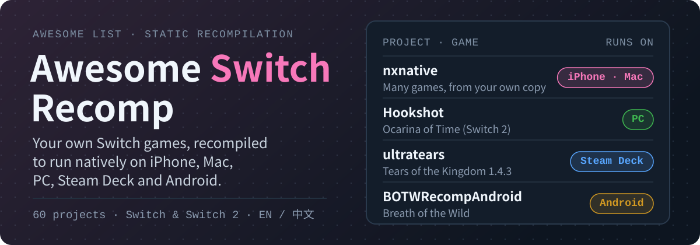

# Awesome Switch Recomp：用你自己的 Switch 游戏，原生跑在 iPhone、Mac、PC 和 Android 上 

[English](README.md) · **简体中文**

  

  
  
  

**任天堂 Switch 和 Switch 2 游戏的静态重编译（recomp）和原生移植项目清单，按你想在哪台设备上玩来分类。这里每个项目都要求用你自己拥有的游戏来构建：不提供 ROM、不提供密钥、不提供下载。**

> 非官方清单，与任天堂及所列项目无关。本清单只链接源代码，不托管、不链接、也不讲解如何获取游戏、密钥或固件。

**[按设备找](#按设备找)** · **[按游戏找](#按游戏找)** · **[需要准备什么](#需要准备什么)** · **[recomp 和模拟器的区别](#recomp-和模拟器的区别)** · **[推荐项目](https://github.com/AIshihzong/awesome-switch-recomp/issues/new?template=project.yml)**

> ⭐ **[给本仓库点个 Star](https://github.com/AIshihzong/awesome-switch-recomp)**，以后能在 GitHub 动态里看到更新；或者 **Watch → Custom → Releases**，每周收到一份新项目汇总。

2026 年 10 月，Switch recomp 突然爆发：[nxnative](https://github.com/seedds/nxnative) 让 Switch 游戏跑上了 iPhone 和 Mac，几周之内王国之泪、时之笛（Switch 2）、旷野之息等几十款游戏陆续有了 PC 和 Android 版本，其中很多是用 AI 编码 Agent 写的。本清单按设备整理了其中 <!-- COUNT -->60<!-- /COUNT --> 个，每个都写清楚：

- **游戏**和**运行设备**：哪款游戏，能在哪些设备上跑。
- **游戏版本**：你的 dump 必须是哪个更新版本。多数项目只支持一个版本。
- **状态**：🟢 可玩，指 README 说可以正常游玩；🟡 早期，指能启动或进入游戏，但问题很多；🧰 工具，指支持多款游戏的构建工具或应用。
- 🤖：README 写明主要由 AI 编码 Agent 编写。

> Star 数和各项信息于 <!-- DATE -->2026-11-10<!-- /DATE --> 逐个阅读项目 README 核对。这些项目每天都在变，开始前请先看项目自己的页面。

## 目录

- [按设备找](#按设备找)
- [按游戏找](#按游戏找)
- [需要准备什么](#需要准备什么)
- [iPhone、iPad 和 Mac](#iphoneipad-和-mac)
- [Windows、Linux 和 Steam Deck](#windowslinux-和-steam-deck)
- [Android](#android)
- [重编译器：自己移植一款游戏](#重编译器自己移植一款游戏)
- [反方向：重编译到 Switch 上运行的游戏](#反方向重编译到-switch-上运行的游戏)
- [recomp 和模拟器的区别](#recomp-和模拟器的区别)
- [相关清单](#相关清单)
- [参与贡献](#参与贡献)

## 按设备找

| 想在哪里玩 | 从这里开始 |
| --- | --- |
| **iPhone 或 iPad** | [NX2Apple](https://github.com/LNPANDY/NX2Apple)（Mac 上一键打包，不用命令行）或 [S2Arm](https://github.com/jhaizhou-ops/S2Arm)。构建需要一台 Mac；只有 Windows 的话用 [ns2ios-shell](https://github.com/xinerqu/ns2ios-shell)。 |
| **Mac**（Apple Silicon） | [switch2mac](https://github.com/azmasm/switch2mac)、[NX Play](https://github.com/varyform/nx-native-wrapper)、[LumaNX 璃游](https://github.com/Xc1Ym/LumaNX)，都基于 [nxnative](https://github.com/seedds/nxnative) |
| **Windows 或 Linux 电脑** | 一款游戏一个项目，见[按游戏找](#按游戏找) |
| **Steam Deck** | 有 Linux 版的项目，例如 [ultratears](https://github.com/kuraeow/ultratears)、[Recompia](https://github.com/Dittobyte/Recompia)、[xc3-recomp](https://github.com/jmars125/xc3-recomp) |
| **Android 手机或掌机** | 多款游戏用 [DroidPlay Core](https://github.com/enjoyerofslop/droidplay-core)；两款塞尔达用 [BOTWRecompAndroid](https://github.com/mamcjr/BOTWRecompAndroid) 和 [TOTKDroid](https://github.com/mamcjr/TOTKDroid) |

## 按游戏找

| 游戏 | PC 和 Steam Deck | iPhone、iPad、Mac | Android |
| --- | --- | --- | --- |
| **塞尔达传说 王国之泪** | [totk-pc-recomp](https://github.com/valentderah/totk-pc-recomp)、[ultratears](https://github.com/kuraeow/ultratears)、[Weeping of the Empire](https://github.com/daniel-madrid-07/weeping-of-the-empire) | [totk-mobile](https://github.com/OJZen/totk-mobile)、[totk-ios](https://github.com/NicholasDominici/totk-ios) | [TOTKDroid](https://github.com/mamcjr/TOTKDroid)、[totk-android](https://github.com/AurelioB/totk-android) |
| **时之笛（Switch 2）** | [Hookshot](https://github.com/NotRexed/Hookshot)、[echora](https://github.com/Mars7x/echora) | [HookLink](https://github.com/dsi-hub/HookLink)、[GreenKid-MV](https://github.com/adi0900/GreenKid-MV) | – |
| **塞尔达传说 旷野之息** | [SavageWindRecomp](https://github.com/Revivedx/SavageWindRecomp) | [NX2Apple](https://github.com/LNPANDY/NX2Apple) 里有配置 | [BOTWRecompAndroid](https://github.com/mamcjr/BOTWRecompAndroid) |
| **织梦岛** | [LASRecomp](https://github.com/peiikai/LASRecomp) | [LASRecomp](https://github.com/peiikai/LASRecomp) | – |
| **马力欧卡丁车 世界（Switch 2）** | [mkw-recomp](https://github.com/adriadam10/mkw-recomp)、[MKW-THWOMP](https://github.com/STS78721/MKW-THWOMP) | [kartnative](https://github.com/pahorema/kartnative) | [DroidPlay Core](https://github.com/enjoyerofslop/droidplay-core)（能启动） |
| **任天堂明星大乱斗 特别版** | [OpenSmash Ultimate](https://github.com/OpenSmash-Ultimate/OpenSmash-Ultimate) | – | – |
| **宝可梦** | [Recompia](https://github.com/Dittobyte/Recompia)（Pokopia）、[KarPur](https://github.com/Grunttanamo/KarPur)（朱/紫）、[letsgo-recomp](https://github.com/raulzrrs/letsgo-recomp)、[swsh-recomp](https://github.com/raulzrrs/swsh-recomp) | – | [letsgo-recomp-android](https://github.com/CowKillers/letsgo-recomp-android) |
| **异度神剑** | [xc3-recomp](https://github.com/jmars125/xc3-recomp)、[xcx-recomp](https://github.com/jmars125/xcx-recomp)、[xc2-recomp](https://github.com/AksharDP/xc2-recomp) | – | – |
| **密特罗德** | [mp4-recomp](https://github.com/linuxopt/mp4-recomp)、[metroid-prime-4-recomp](https://github.com/jaigner-hub/metroid-prime-4-recomp)、[Metroid-Dread-Recomp](https://github.com/yozander2009-stack/Metroid-Dread-Recomp) | – | – |
| **大金刚 蕉力全开（Switch 2）** | [dkb-pc-recomp](https://github.com/Lucas-blip-png/dkb-pc-recomp) | – | – |
| **暗黑破坏神 II：狱火重生** | – | [d2r-mobile](https://github.com/jhaizhou-ops/d2r-mobile) | [d2r-mobile](https://github.com/jhaizhou-ops/d2r-mobile) |

## 需要准备什么

1. **你自己的主机和你自己的正版游戏**，卡带或 eShop 购买的都可以。这里每个项目都是用你自己 dump 的文件构建，不附带任何游戏数据。本清单不讲解如何 dump 游戏或密钥，也不链接讲解这些的地方。
2. **项目 README 指定的游戏版本**。更新版本不对的 dump 通常无法构建，先看“游戏版本”这一列。
3. **够用的设备**。苹果相关项目需要 Apple Silicon；PC 项目通常需要支持 Vulkan 的显卡；Android 项目通常需要较新的骁龙芯片。
4. **一点耐心**。多数项目才出现几周，会崩溃、会有画面问题，请先看每个项目的已知问题。
5. **只从项目自己的 GitHub Releases 下载**。打着这些项目名号提供“已构建好的游戏”的网站不是这些项目本身，而且构建好的游戏里含有任天堂的代码。

### AI 编写

标 🤖 的项目在 README 里写明主要代码由 Claude Code、Codex 等 AI 编码 Agent 编写。[ns-game-apple-arm-port](https://github.com/realskyrin/ns-game-apple-arm-port) 本身就是一个把游戏移植到 Apple Silicon 的 Agent 技能。想看 AI Agent 还逆向过哪些东西，见 [Awesome REA](https://github.com/AIshihzong/awesome-reverse-engineer-anything)。

## iPhone、iPad 和 Mac

<!-- BEGIN apple -->
只支持 Apple Silicon（M1 及以后的 Mac、较新的 iPhone 或 iPad）。多数基于 [nxnative](https://github.com/seedds/nxnative)：在 Mac 上用工具指向你自己的游戏文件，生成 Mac 应用，或者生成 IPA 侧载到 iPhone、iPad。很多还需要从你自己主机 dump 的 `prod.keys`。

| 项目 | ★ | 游戏 | 运行设备 | 游戏版本 | 状态 | 说明 |
| --- | ---: | --- | --- | --- | --- | --- |
| [nxnative](https://github.com/seedds/nxnative) | 14.4k | 多款 | iPhone/iPad, Mac | – | 🧰 工具 | 把你自己的 NSP 文件夹变成未签名的 iPhone/iPad 应用或 Mac 应用：游戏代码改写为 ARM64，画面直接走 Metal。下面多数苹果工具都基于它。 |
| [NX2Apple](https://github.com/LNPANDY/NX2Apple) | 5,921 | 多款 | iPhone/iPad | – | 🧰 工具 | Mac 上的一键图形界面，把你自己的游戏打包成 iPhone/iPad 应用，不用命令行。已有 147 款游戏的配置。 |
| [d2r-mobile](https://github.com/jhaizhou-ops/d2r-mobile) 🤖 | 5,252 | 暗黑破坏神 II：狱火重生 | iPhone/iPad, Mac, Android | – | 🟢 可玩 | 把你自己的 Switch 版原生跑在 iPhone、iPad、Mac 和 Android 上，完整触控，稳定 60 帧。 |
| [S2Arm](https://github.com/jhaizhou-ops/S2Arm) | 2,342 | 多款 | iPhone/iPad, Mac | – | 🧰 工具 | 一个应用装下整个游戏库，支持 iPhone、iPad 和 Mac，带游戏内设置和可编辑的虚拟手柄。游戏和密钥自备。 |
| [ns-game-apple-arm-port](https://github.com/realskyrin/ns-game-apple-arm-port) 🤖 | 534 | 任意 | iPhone/iPad, Mac | – | 🧰 工具 | Agent 技能：让编码 Agent 用 Rust 和 Metal 把一款 Switch 游戏移植到 Apple Silicon（macOS、iPadOS、iOS）。 |
| [LumaNX 璃游](https://github.com/Xc1Ym/LumaNX) | 292 | 多款 | iPhone/iPad, Mac | – | 🧰 工具 | nxnative 的中英文 Mac 图形界面：图形化构建游戏，可在 Mac 上运行，也能导出 iPhone/iPad 的 IPA。 |
| [totk-mobile](https://github.com/OJZen/totk-mobile) | 209 | 王国之泪 | iPhone/iPad, Mac | 1.4.3 | 🟡 早期 | 实验性原生移植，支持 Apple Silicon Mac 和 iPad，iPhone 版处于早期。构建前会校验你的游戏文件。 |
| [NX Play](https://github.com/varyform/nx-native-wrapper) 🤖 | 165 | 多款 | iPhone/iPad, Mac | – | 🧰 工具 | Mac 应用，用来构建、游玩、安装和管理 nxnative 游戏，支持 Mac 和 iPhone/iPad。 |
| [switch2mac](https://github.com/azmasm/switch2mac) | 155 | 多款，含 Switch 2 | Mac | – | 🧰 工具 | Mac 应用，把你自己 dump 的 Switch 和 Switch 2 游戏变成原生 Apple Silicon 应用，带游戏盒式的游戏库。不是模拟器。 |
| [MetalNX](https://github.com/krushant1122/MetalNX) | 81 | 多款 | Mac | – | 🧰 工具 | 面向 M1 到 M4 Mac 的一键 Switch 转 Mac 移植工具和画面调节器，带兼容列表。 |
| [GreenKid-MV](https://github.com/adi0900/GreenKid-MV) | 79 | 时之笛（Switch 2） | Mac | – | 🧰 工具 | 不含游戏的 Mac 构建器，在 Apple Silicon 上原生运行时之笛（Switch 2）。用你自己的 dump 在本机构建。 |
| [kartnative](https://github.com/pahorema/kartnative) | 61 | 马力欧卡丁车 世界（Switch 2） | Mac | – | 🟢 可玩 | nxnative 的分支，把 Switch 2 图形（NVN2）转到 Metal。在 Apple Silicon Mac 上能完整跑完大奖赛杯赛。 |
| [ns2ios-shell](https://github.com/xinerqu/ns2ios-shell) | 48 | 多款 | iPhone/iPad | – | 🧰 工具 | 在 Windows 上就能打包 iPhone 的 IPA，不需要 Mac，用你自己的 NSP 和 prod.keys。 |
| [totk-ios](https://github.com/NicholasDominici/totk-ios) 🤖 | 45 | 王国之泪 | iPhone/iPad | – | 🟡 早期 | 实验性的 iPad 和 iPhone 原生版本，用你自己的游戏文件构建成个人应用。 |
| [manosaba-ios](https://github.com/iceorange-dev/manosaba-ios) | 38 | 王国之泪、魔法少女的魔女审判 | iPhone/iPad, Mac | – | 🟡 早期 | 王国之泪跑在 iPhone 和 Mac 上，魔法少女的魔女审判跑在 iPhone、iPad 和 Mac 上。基于 d2r-mobile。 |
| [HookLink](https://github.com/dsi-hub/HookLink) | 35 | 时之笛（Switch 2） | iPhone/iPad | – | – | 时之笛（Switch 2 版）跑在 iPhone 上，在你的 Mac 上用你自己的游戏构建。 |
| [AC-Recomp](https://github.com/swaymun/AC-Recomp) 🤖 | 29 | 异界锁链 | Mac, Windows, Linux | – | 🟡 早期 | 实验性静态重编译，主要面向 macOS，Windows 和 Linux 版处于早期。能玩到第一章的摩托追逐。 |
| [nxnative-easy](https://github.com/nalancer08/nxnative-easy) | 23 | 多款 | iPhone/iPad, Mac | – | 🧰 工具 | 一条命令装好 nxnative：生成完整 Mac 应用和轻量 iPhone 版，支持 Xbox、PlayStation 手柄和可编辑触控。 |
<!-- END apple -->

## Windows、Linux 和 Steam Deck

<!-- BEGIN pc -->
每款游戏是一个独立项目，只支持 README 里写的游戏版本，其他更新版本的 dump 无法构建。项目有 Linux 版的，一般也能在 Steam Deck 上跑。

| 项目 | ★ | 游戏 | 运行设备 | 游戏版本 | 状态 | 说明 |
| --- | ---: | --- | --- | --- | --- | --- |
| [totk-pc-recomp](https://github.com/valentderah/totk-pc-recomp) 🤖 | 6,363 | 王国之泪 | Windows, Linux | – | 🟢 可玩 | 静态重编译为原生 Windows 和 Linux 程序，Vulkan 渲染。可以玩，但仍有画面问题和崩溃。 |
| [Hookshot](https://github.com/NotRexed/Hookshot) | 6,204 | 时之笛（Switch 2） | Windows, Linux | – | 🟢 可玩 | 时之笛 Switch 2 重制版的原生重编译，带游戏内菜单、插帧和超分。不含游戏、密钥或可执行文件。 |
| [SavageWindRecomp](https://github.com/Revivedx/SavageWindRecomp) 🤖 | 3,788 | 旷野之息 | Windows, Linux | 1.9.0 | 🟡 早期 | 面向 Windows 和 Linux 的静态重编译 Alpha 版，几乎全部由 AI 完成。不含游戏文件、密钥或 dump 工具。 |
| [LASRecomp](https://github.com/peiikai/LASRecomp) 🤖 | 2,300 | 织梦岛 | Mac, Windows, Linux | 1.0.0 / 1.0.1 / 1.1.0 | 🟢 可玩 | 静态重编译 Beta 版，支持 Windows、Linux 和 macOS，几乎全部由 AI 完成。这里好几个项目都基于它。 |
| [ultratears](https://github.com/kuraeow/ultratears) | 853 | 王国之泪 | Windows, Linux, Steam Deck | 1.4.3 | – | 非官方的原生 PC 和 Steam Deck 移植，用你自己解包的 dump 在本机构建。 |
| [dkb-pc-recomp](https://github.com/Lucas-blip-png/dkb-pc-recomp) 🤖 | 693 | 大金刚 蕉力全开（Switch 2） | Windows | – | 🟡 早期 | 静态重编译为原生 Windows 程序，Vulkan 渲染。能玩完第一关，仍处于早期，会崩溃。 |
| [B2recomp](https://github.com/K0NL/B2recomp) 🤖 | 595 | 猎天使魔女 2 | Windows | 1.2 | 🟢 可玩 | 非官方静态重编译，Windows 版，用你自己的 dump 在电脑上构建。Beta 版。 |
| [Recompia](https://github.com/Dittobyte/Recompia) 🤖 | 538 | 宝可梦 Pokopia（Switch 2） | Windows, Linux, Steam Deck | 2.0.1a | 🟢 可玩 | 原生 Windows 版，也支持 Linux 和掌机，带联机、模组和键鼠操作。 |
| [Metroid-Dread-Recomp](https://github.com/yozander2009-stack/Metroid-Dread-Recomp) 🤖 | 391 | 密特罗德 生存恐惧 | Windows, Linux | – | 🟡 早期 | 静态重编译，自带编译器、启动和设置界面以及游戏内菜单。目前 0.x 版本是早期预览。 |
| [Weeping of the Empire](https://github.com/daniel-madrid-07/weeping-of-the-empire) 🤖 | 315 | 王国之泪 | Windows | 1.0.0 (1.4.3 beta) | 🟢 可玩 | 原生 Windows 版，Vulkan 渲染，帧率上限可到 240，支持 DLSS 和键鼠。主要由 AI Agent 编写。 |
| [xc2-recomp](https://github.com/AksharDP/xc2-recomp) 🤖 | 288 | 异度神剑 2 | Windows | 3.0.0 | 🟡 早期 | 静态重编译为原生 Windows 程序，Vulkan 渲染。能进标题画面，新游戏可以玩过开场。 |
| [letsgo-recomp](https://github.com/raulzrrs/letsgo-recomp) | 287 | 宝可梦 Let's Go！伊布 | Windows | 1.0.0 | 🟡 早期 | 基于 LAS Recomp 的原生 Windows 移植。仍在开发，还没有完整通关过。 |
| [xcx-recomp](https://github.com/jmars125/xcx-recomp) 🤖 | 284 | 异度神剑 X 终极版 | Windows, Linux, Steam Deck | 2.0.0 | 🟡 早期 | 静态重编译为原生 Windows 程序，Vulkan 渲染。新游戏、过场和战斗都能跑。 |
| [mkw-recomp](https://github.com/adriadam10/mkw-recomp) 🤖 | 269 | 马力欧卡丁车 世界（Switch 2） | Windows, Linux | 1.0.0 | 🟡 早期 | 静态重编译为原生 PC 程序。在 Linux 和 Windows 上能启动、播开场、跑比赛，部分菜单还在修。 |
| [OpenSmash Ultimate](https://github.com/OpenSmash-Ultimate/OpenSmash-Ultimate) 🤖 | 129 | 任天堂明星大乱斗 特别版 | Windows, Linux | 13.0.4 | 🟢 可玩 | 整个游戏变成原生 PC 程序：所有模式、DLC 角色和场景，带安装程序。原名 ssbu-recomp。 |
| [EoWRecomp](https://github.com/Nycolazs/EoWRecomp) 🤖 | 119 | 智慧的再现 | Windows, Linux, Android | 1.0.0 | 🟡 早期 | 静态重编译为原生 PC 程序，另有 Alpha 版 Android 应用。能启动并玩开场。 |
| [MKW-THWOMP](https://github.com/STS78721/MKW-THWOMP) | 108 | 马力欧卡丁车 世界（Switch 2） | Windows | 1.8.0 | 🟡 早期 | 静态重编译为原生 Windows 程序，Vulkan 渲染。开场、标题和菜单能显示，比赛能载入，还不能完整游玩。 |
| [totk-recomp](https://github.com/Muhammad1259-sigma/totk-recomp) | 104 | 王国之泪 | Linux, Steam Deck | 1.0.0 | – | 静态重编译为原生 Linux x86-64 程序，主要面向 Steam Deck。dump 和密钥自备。 |
| [xc3-recomp](https://github.com/jmars125/xc3-recomp) 🤖 | 98 | 异度神剑 3 | Windows, Linux, Steam Deck | 2.2.1 | 🟢 可玩 | 从新游戏开始可以玩主线、过场和战斗，支持全部四个 DLC。 |
| [totk-launcher](https://github.com/FurkanAnc/totk-launcher) | 89 | 王国之泪 | Windows | – | 🧰 工具 | 王国之泪 PC recomp 的启动器：设置、改键、键鼠按键提示、成就和存档备份。 |
| [mp4-recomp](https://github.com/linuxopt/mp4-recomp) 🤖 | 88 | 密特罗德 究极 4 穿越 | Windows, Linux, Steam Deck | – | 🟢 可玩 | 经过长时间试玩修复的静态重编译：能启动、游玩、扫描，声音正常，带游戏内菜单。 |
| [smo-recomp](https://github.com/Coz-0/smo-recomp) | 81 | 超级马力欧 奥德赛 | Windows | 1.4.1 | 🟡 早期 | 静态重编译为原生 Windows x64 程序。早期，尚未完成。 |
| [SuperWonders](https://github.com/vfjoo888/SuperWonders) 🤖 | 37 | 超级马力欧兄弟 惊奇 | Windows | 1.0.0 | – | 原生 PC 静态重编译，从 DKB 和 TotK recomp 起步，带 F1 游戏内菜单。 |
| [echora](https://github.com/Mars7x/echora) | 32 | 时之笛（Switch 2） | Windows, Linux | 1.1.1 | 🟡 早期 | 时之笛 Switch 2 版的实验性原生重编译。 |
| [swsh-recomp](https://github.com/raulzrrs/swsh-recomp) | 30 | 宝可梦 剑 / 盾 | Windows | 1.3.2 | 🟡 早期 | 基于 Let's Go Recomp 和 LAS Recomp 的原生 Windows 移植，已测试扩展票。仍在开发。 |
| [oot-pc-recomp](https://github.com/Chiuauaa/oot-pc-recomp) 🤖 | 30 | 时之笛（Switch 2） | Windows, Linux | – | 🟡 早期 | PC 静态重编译。还不能玩。 |
| [KarPur](https://github.com/Grunttanamo/KarPur) 🤖 | 26 | 宝可梦 朱 / 紫 | Windows, Linux, Steam Deck | 4.0.0 | 🟢 可玩 | 基于 LAS Recomp 和 TotK Recomp 的原生 Windows 移植。从标题画面进入开放世界、对战都能玩。 |
| [metroid-prime-4-recomp](https://github.com/jaigner-hub/metroid-prime-4-recomp) | 17 | 密特罗德 究极 4 穿越 | Windows | 1.1.0 | 🟢 可玩 | 从头就能玩：标题、菜单、存档和开场动画都正常。针对 Switch 1 的最终更新版本。 |
| [KirbyRecomp](https://github.com/xtamqispeak/KirbyRecomp) | 16 | 超级星之卡比 大乱斗 | Windows | – | 🟡 早期 | 实验性 Alpha 版 Windows 静态重编译，用你自己的 ExeFS 和 RomFS 在本机构建。 |
<!-- END pc -->

## Android

<!-- BEGIN android -->
手机和 Android 掌机（AYN Odin、Thor，Retroid Pocket 等）。一般要求较新的骁龙芯片和 Adreno GPU。

| 项目 | ★ | 游戏 | 运行设备 | 游戏版本 | 状态 | 说明 |
| --- | ---: | --- | --- | --- | --- | --- |
| [BOTWRecompAndroid](https://github.com/mamcjr/BOTWRecompAndroid) 🤖 | 726 | 旷野之息 | Android | 1.0.0 / 1.6.0 / 1.8.2 | 🟢 可玩 | 面向 Android 的静态重编译：从标题画面进入世界都能玩，支持存档和触控。 |
| [TOTKDroid](https://github.com/mamcjr/TOTKDroid) 🤖 | 226 | 王国之泪 | Android | 1.4.3 | – | 原生 Android 版，支持触控、模组和宽屏。原名 TOTKRecompAndroid。 |
| [totk-android](https://github.com/AurelioB/totk-android) | 135 | 王国之泪 | Android | 1.4.3 | – | 原生 Android 移植，菜单、地图和文字按屏幕原生分辨率绘制，自动备份存档。 |
| [DOOM Mobile](https://github.com/Desm0nt/doom-port) | 85 | 毁灭战士（2016） | Android | – | 🟢 可玩 | 毁灭战士 Switch 版原生跑在 ARM64 Android 上，Vulkan 渲染。战役可以玩。 |
| [DroidPlay Core](https://github.com/enjoyerofslop/droidplay-core) | 81 | 多款，含 Switch 2 | Android | – | 🧰 工具 | nxnative 的 Android 版：Switch 和 Switch 2 游戏原生跑在 Android 上，Vulkan 渲染。列出了各游戏在掌机和手机上的表现。 |
| [diablo3-port](https://github.com/Desm0nt/diablo3-port) | 51 | 暗黑破坏神 III | Android | – | – | 暗黑破坏神 III 的 Switch 版移植为原生 ARM64 Android 程序，支持触控手势。源自 d2r-mobile。 |
| [dsr-native](https://github.com/kvse/dsr-native) | 37 | 黑暗之魂 重制版 | Android | 1.0.0 | 🟢 可玩 | 面向 Android 的静态重编译。非常早期，但大部分内容能以稳定 60 帧游玩。 |
| [letsgo-recomp-android](https://github.com/CowKillers/letsgo-recomp-android) | 23 | 宝可梦 Let's Go！伊布 | Android | – | 🟡 早期 | letsgo-recomp 的 Android 版。世界、战斗和存档能用，但文字还显示不出来。README 是葡萄牙语。 |
| [totkonandroid](https://github.com/AYNThorDeveloper/totkonandroid) | 16 | 王国之泪 | Android | – | 🟡 早期 | 实验性 ARM64 Android 运行时，以 AYN Thor 掌机为参考设备。只有源码。 |
<!-- END android -->

## 重编译器：自己移植一款游戏

<!-- BEGIN tools -->
通用工具，适合想给还没有人做的游戏做重编译的开发者。

| 项目 | ★ | 游戏 | 运行设备 | 游戏版本 | 状态 | 说明 |
| --- | ---: | --- | --- | --- | --- | --- |
| [SwitchRECOMP](https://github.com/SwitchRECOMP-Dev/SwitchRECOMP) | 182 | 任意 | Windows, Linux | – | 🧰 工具 | Switch 游戏的静态重编译器：把 ARM64 代码一次性翻译成 C，再编译成原生 Windows 或 Linux 程序。不含游戏、密钥或固件。 |
| [kirikae](https://github.com/Cor3Duo/kirikae) | 95 | 任意 | Windows, Linux | – | 🧰 工具 | 用 Rust 写的静态重编译器，把 Switch 可执行文件变成原生 PC 程序。早期预览，已经能跑完整的 3D 游戏。 |
| [Switch2RECOMP](https://github.com/SwitchRECOMP-Dev/Switch2RECOMP) | 30 | 任意，含 Switch 2 | Windows, Linux | – | 🧰 工具 | Switch 和 Switch 2 游戏的静态重编译器，支持 Windows 和 Linux，OpenGL 和 Vulkan。 |
| [nxrecomp](https://github.com/drakolordx7/nxrecomp) | 16 | 密特罗德 究极 复刻版 | Windows | – | 🧰 工具 | 让 Switch 游戏原生跑在 Windows 上的通用重编译器、运行时和工具，第一个目标是密特罗德 究极 复刻版。 |
<!-- END tools -->

## 反方向：重编译到 Switch 上运行的游戏

<!-- BEGIN on-switch -->
这些不是 Switch 游戏，而是把 Xbox 360、GameCube、Wii U 和 PC 游戏重编译成 Switch 自制程序。需要能运行自制程序的主机，以及你自己的原版游戏。

- [nfsmw-nx](https://github.com/StevensND/nfsmw-nx) (266 ★): 极品飞车 9 最高通缉（Xbox 360）跑在 Switch 上。
- [SwitchWakerHD](https://github.com/centollOS/SwitchWakerHD) (249 ★): 风之杖 HD（Wii U）跑在 Switch 上，deko3d 渲染。
- [mcdub3-nx](https://github.com/laureladastra/mcdub3-nx) (110 ★): 午夜俱乐部 3 跑在 Switch 上，也有 Linux、Mac、Android 和 Windows 版。
- [SwitchWaker](https://github.com/centollOS/SwitchWaker) (104 ★): 风之杖（GameCube）跑在 Switch 上。
- [sh2-nx](https://github.com/cutarev/sh2-nx) (55 ★): 寂静岭 2（PC）跑在 Switch 上。
- [mgr-nx-deko](https://github.com/tuancapoo/mgr-nx-deko) (47 ★): 合金装备崛起：复仇（Xbox 360）跑在 Switch 上。
- [sh3-nx](https://github.com/cutarev/sh3-nx) (41 ★): 寂静岭 3（PC）跑在 Switch 上。
- [prototype-switch](https://github.com/fungalspores/prototype-switch) (37 ★): 虐杀原形 1 和 2（Xbox 360）跑在 Switch 上。
- [conker-lr-recomp](https://github.com/rashevskyv/conker-lr-recomp) (33 ★): 松鼠康克（Xbox）跑在 Switch、Linux 和 Windows 上。
- [mk9-nx](https://github.com/Thorhax/mk9-nx) (32 ★): 真人快打 9 完全版（Xbox 360）跑在 Switch 上。
- [gears2-nx](https://github.com/VasilkovND/gears2-nx) (31 ★): 战争机器 2（Xbox 360）跑在 Switch 上。
- [Lazarus](https://github.com/VibePorter/Lazarus) (27 ★): 质量效应 2（Xbox 360）跑在 Switch 上。
- [bo2-360-nx](https://github.com/AlvaroEPena/bo2-360-nx) (23 ★): 使命召唤 黑色行动 II（Xbox 360）跑在 Switch 和 Windows 上。
- [sa2-nx](https://github.com/ChanseyIsTheBest/sa2-nx) (23 ★): 索尼克大冒险 2（XBLA）以 60 帧跑在 Switch 上。
- [usf4-nx](https://github.com/Thorhax/usf4-nx) (22 ★): 终极街头霸王 IV（Xbox 360）跑在 Switch 和 PC 上。
- [the-simpsons-game-nx](https://github.com/R-drg/the-simpsons-game-nx) (19 ★): 辛普森一家（Xbox 360）跑在 Switch 上。
- [NFS-Carbon-NX](https://github.com/zofo007/NFS-Carbon-NX) (18 ★): 极品飞车 10 卡本峡谷（Xbox 360）跑在 Switch 上。
- [lm-nx](https://github.com/StevensND/lm-nx) (16 ★): 路易吉洋馆（GameCube）跑在 Switch 上。
<!-- END on-switch -->

## recomp 和模拟器的区别

**模拟器**（例如 Ryujinx）是假装自己是一台 Switch，在你玩的时候实时运行游戏的原始代码。**静态重编译**（recomp）是提前把游戏代码一次性翻译成你的电脑、Mac、手机或掌机上的原生程序。重编译后的程序不需要模拟器，往往更流畅，还能加上原版没有的东西：更高帧率、超宽屏、键鼠操作、模组。代价是每款游戏都要单独做一个项目，而且每个项目只支持一个游戏版本。

**反编译**（decompilation）更进一步，要靠人工重建出可读的源代码。recomp 做起来快得多，这也是为什么一下子冒出这么多项目。本清单不收录 Switch 模拟器。

## 相关清单

<!-- BEGIN lists -->
- [awesome-decomp-games](https://github.com/SubmitGame/awesome-decomp-games) (3,000 ★): 覆盖所有主机的反编译和重编译大表。
- [awesome-game-decompilations](https://github.com/CharlotteCross1998/awesome-game-decompilations) (834 ★): 游戏反编译项目清单。
- [Awesome REA](https://github.com/AIshihzong/awesome-reverse-engineer-anything) (584 ★): 用 AI Agent 做逆向：这里很多项目背后用到的工具和技能。
- [awesome-recompilations](https://github.com/BlueInterlude/awesome-recompilations) (59 ★): N64 和 Xbox 360 的重编译项目。
<!-- END lists -->

## 参与贡献

发现缺了某个项目，或者信息有误？[开个 issue](https://github.com/AIshihzong/awesome-switch-recomp/issues/new?template=project.yml) 或者直接提 PR，详见 [CONTRIBUTING.md](CONTRIBUTING.md)。

**收录标准**：Switch 和 Switch 2 游戏的开源重编译、原生移植和构建工具，且 README 写明必须使用你自己的游戏。不收录：包含或链接游戏、密钥、固件或已构建游戏的项目；模拟器；闭源工具。

**删除请求**：权利方要求删除某个项目时，会删除对应条目。请开 issue，会优先处理。

**怎么核对的**：“游戏版本”和“状态”两列来自每个项目自己的 README。表格由 [`scripts/build.py`](scripts/build.py) 根据 [`data/projects.json`](data/projects.json) 生成，Star 数每周自动刷新。

如果你的项目被收录，欢迎加上徽章：``

## 许可

[CC0 1.0](LICENSE)。Nintendo Switch 是任天堂的商标，游戏名称和其他商标归各自所有者。

---

同一维护者的其他清单：[Awesome REA](https://github.com/AIshihzong/awesome-reverse-engineer-anything)（经过核实的 AI Agent 逆向和重建案例清单）和 [Awesome TV Debloat](https://github.com/AIshihzong/awesome-tv-debloat)。
